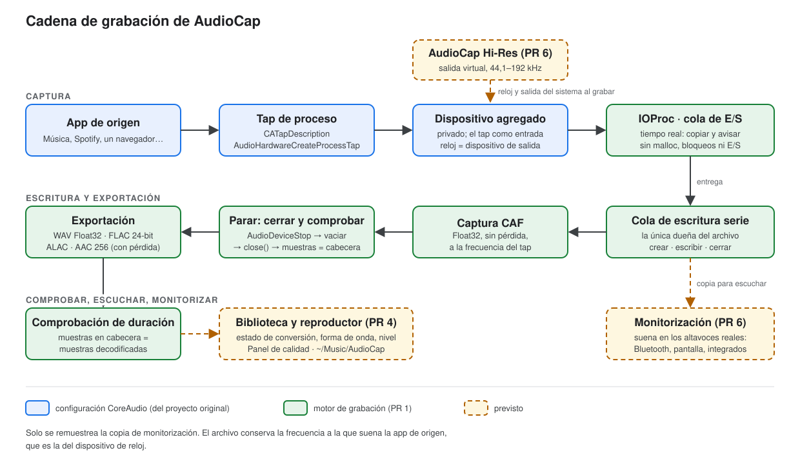
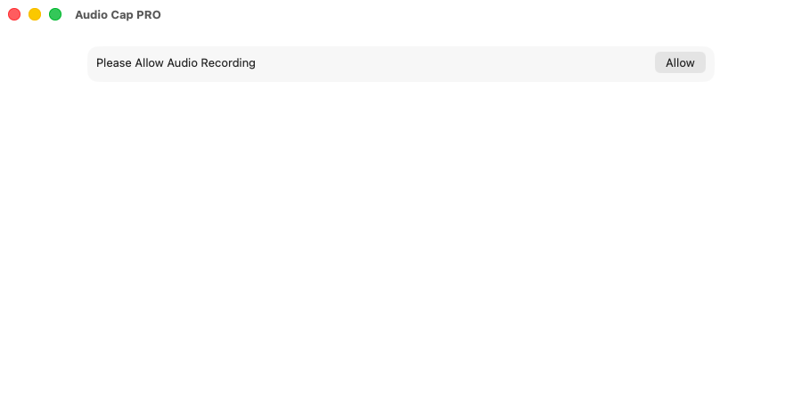
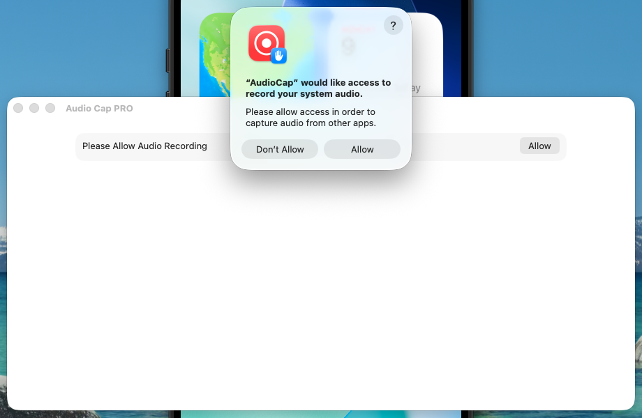
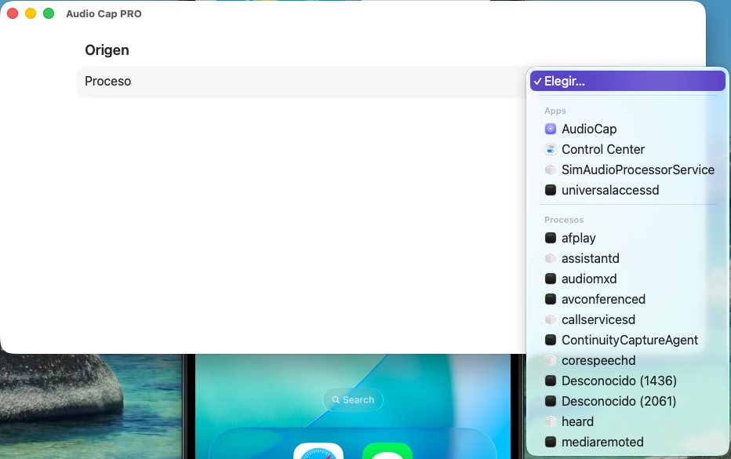
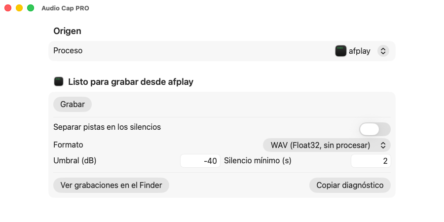
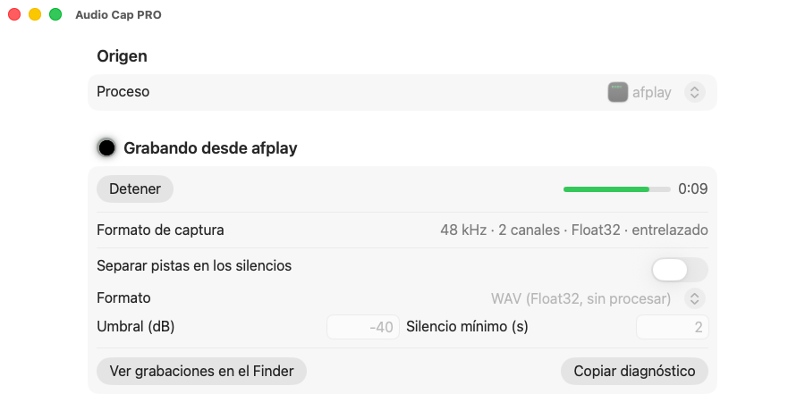
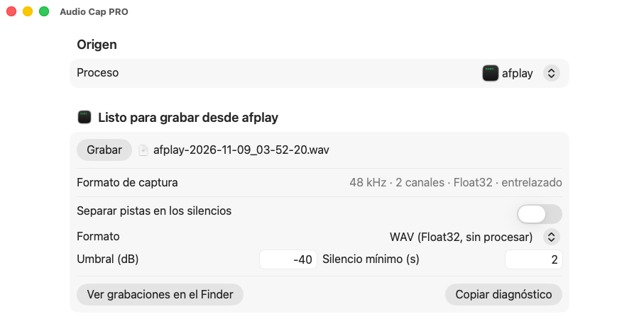

# AudioCap

[English](README.md)

AudioCap graba el sonido de una sola app de tu Mac (Música, Spotify, un navegador…) directamente desde macOS, con los **taps de proceso** de CoreAudio. Sin drivers de bucle, sin micrófono y sin volver a grabar lo que sale por los altavoces.

Este fork se está rehaciendo porque la grabación dejó de funcionar tras una actualización reciente de macOS. El plan está en [`docs/planning/01_improvement_plan.md`](docs/planning/01_improvement_plan.md). Este README indica qué hacía la app antes de rehacerla y qué es **nuevo en esta versión**.



## Funciones

Antes de rehacerla:
- Elige cualquier app que esté sonando y graba solo esa app.
- Guarda en WAV (coma flotante de 32 bits), M4A (AAC) o FLAC.
- Opción de partir la grabación en varios archivos al detectar silencio, con un umbral (dB) y una duración mínima del silencio (segundos).
- Interfaz en español e inglés que sigue el idioma de macOS, con texto de 16 pt como mínimo, colores de alto contraste, etiquetas para VoiceOver y control con el teclado (**⌘R** empieza y detiene la grabación).

Novedades de esta versión (los detalles están en el plan):
- **Nuevo motor de grabación** (PR 1): captura sin pérdida en CAF, FLAC de 24 bits, ALAC, WAV Float32 y AAC a 256 kbps; comprobación de duración en cada archivo; códigos de error descifrados y un botón **Copiar diagnóstico**.
- **Grabación automática** (PR 3, "Esperar sonido", el modo por defecto): pulsa **Start** para dejarla a la espera; la toma empieza cuando el origen suena (con hasta medio segundo previo: menos si el origen empieza a sonar después de pulsar Start) y termina tras 2 s de silencio (ajustable), y vuelve a esperar. El modo **Manual** graba de Start a Stop. Además, una fuente "Todo el audio del sistema" (todo menos AudioCap).
- **Biblioteca y reproductor** (PR 4): cada toma con su estado (grabando, convirtiendo, lista, con error), un reproductor con forma de onda, un medidor de nivel, un panel de **Calidad** y la carpeta de destino `~/Music/AudioCap`.
- **Modo Hi-Res** (PR 6): graba a la frecuencia completa del original (hasta 192 kHz) aunque escuches por Bluetooth o por los altavoces de la pantalla. `./start.sh` ofrece instalar una vez el dispositivo `AudioCap Hi-Res` (o ejecuta `./start.sh --install-driver`); se desactiva en AudioCap > Ajustes.

## Requisitos

- Un Mac con **macOS 26** o posterior. La API de taps de proceso existe desde macOS 14.4, pero ahora mismo el proyecto exige macOS 26.0.
- **Xcode** (aquí se ha compilado con Xcode 26.6). Instálalo desde la App Store, ábrelo una vez y, si no se encuentra `xcodebuild`, ejecuta `sudo xcode-select -s /Applications/Xcode.app`.
- Permiso para grabar el audio del sistema (macOS lo pide la primera vez).

No funciona en Windows ni en Linux: los taps de proceso son una API de CoreAudio, exclusiva de macOS.

## Instalación

```
git clone https://github.com/juliatic/AudioCap.git
cd AudioCap
./start.sh
```

`./start.sh` comprueba que Xcode está instalado, compila una versión Release, la instala como `/Applications/AudioCap.app` y la abre desde ahí. Si AudioCap ya está abierta, primero la cierra y sustituye la copia antigua de `/Applications`; si la compilación falla, no toca nada en `/Applications`. Si tu usuario no puede escribir en `/Applications`, el script pide una sola vez la contraseña de administrador o se detiene con un mensaje claro. Otras opciones:

| Orden | Qué hace |
|-------|----------|
| `./start.sh` | compila, instala en `/Applications` y abre la app |
| `./start.sh --no-open` | compila e instala en `/Applications`, sin abrirla |
| `./start.sh --no-install` | solo compila en `./build/AudioCap.app` (no toca `/Applications`) |
| `./start.sh --test` | ejecuta las pruebas unitarias (objetivo `AudioCapTests`, que llega con el nuevo motor) |
| `./start.sh --help` | muestra todas las opciones |

Sin Team ID la app se firma ad hoc, así que macOS puede volver a pedir el permiso de grabación de audio la primera vez que abres cada copia recompilada o firmada de nuevo. También lo pedirá una vez cuando cambie el identificador de la app (bundle ID) con el nuevo motor. Para evitarlo, crea `AudioCap/Config/Local.xcconfig` (Git lo ignora) con tu Team ID de Apple:

```
DEVELOPMENT_TEAM = XXXXXXXXXX
```

## Uso

1. Abre AudioCap, pulsa **Permitir** y confírmalo en el aviso de macOS.

   
   

2. Pon a sonar la app que quieres grabar y elígela en la lista.

   

3. Elige el formato (y, si quieres, el corte por silencio) y pulsa **Grabar**.

   
   

4. Pulsa **Detener**. Cuando el archivo se ha escrito, aparece su nombre.

   

Ahora mismo las grabaciones se guardan en el contenedor de la app: `~/Library/Containers/codes.rambo.samplecode.AudioCap/Data/Library/Application Support/AudioCap` (lo explica [Solución de problemas](docs/troubleshooting.es.md#dónde-se-guardan-las-grabaciones)).

La interfaz sigue el idioma de macOS: en español si el Mac está en español y en inglés en los demás casos. Para probar el otro idioma, ejecuta `open -n /Applications/AudioCap.app --args -AppleLanguages "(en)"`. Pulsa **⌘R** para empezar o detener una grabación, **Retorno** para el botón resaltado y **Tab** para pasar de un control a otro (con *Navegación con teclado* activada en Ajustes del Sistema > Teclado).

## Calidad de grabación

En pocas palabras: sin pérdida, pero idéntica bit a bit solo cuando coinciden las frecuencias de muestreo.

- **Profundidad de bits:** el tap entrega coma flotante de 32 bits, que representa exactamente el audio de 16 y 24 bits. El WAV conserva esos datos; FLAC y ALAC (nuevo motor) guardan 24 bits.
- **Frecuencia de muestreo:** un tap graba a la frecuencia a la que suena la app de origen, y la app suena a la frecuencia de tu **dispositivo de salida**. Si una pista de 96 kHz suena por unos auriculares Bluetooth o una pantalla a 48 kHz, se remuestrea antes de llegar a AudioCap. Para una copia idéntica, pon el dispositivo de salida a la frecuencia del original (Configuración de Audio MIDI). El modo Hi-Res elimina esta limitación: mientras grabas, la reproducción va al dispositivo silencioso `AudioCap Hi-Res` a una frecuencia alta (la de la pista de Música o 96 kHz por defecto) y AudioCap reproduce una copia en tus altavoces o auriculares. Al detener vuelve tu salida anterior.
- **Canales:** el sonido envolvente y Atmos se mezclan a estéreo.
- **Ajustes de la app de origen:** un volumen de la app por debajo del 100 %, el ecualizador, Sound Check y el audio espacial modifican el sonido antes del tap.
- **AAC/M4A comprime con pérdida.** Para conservar el original usa WAV, FLAC o ALAC.

Cómo comprobarlo en tu propio Mac (prueba de nulo y comprobación de duración): [`.agents/skills/audiocap-audio-quality/SKILL.md`](.agents/skills/audiocap-audio-quality/SKILL.md) (en inglés).

## Solución de problemas

- [Guía de solución de problemas](docs/troubleshooting.es.md): códigos de error descifrados (`'fmt?'`, `'!obj'`…), cómo restablecer el permiso, dónde se guardan los archivos, qué hacer si salen vacíos o cortos y por qué una toma puede avisar de un corte de golpe donde el original se corta de verdad (AudioCap no puede distinguirlo de que CoreAudio entregue ceros).
- [Notas sobre los taps de proceso de CoreAudio](docs/coreaudio-taps.md) para desarrolladores (en inglés).
- Si quieres colaborar, o eres una herramienta de IA, empieza por [`AGENTS.md`](AGENTS.md).

## Créditos

AudioCap se basa en [insidegui/AudioCap](https://github.com/insidegui/AudioCap), el ejemplo original que documenta la API de taps de proceso de macOS 14.4. Gracias a su autor y a [@WFT](https://github.com/WFT), que colaboró en el proyecto original. La licencia original se mantiene en [`LICENSE`](LICENSE) (BSD de 2 cláusulas).

Patrocinador del proyecto original, tal como aparecía en su README:

> **Sponsor: Recall.ai - API for desktop recording**
>
> If you’re looking for a hosted desktop recording API, consider checking out [Recall.ai](https://www.recall.ai/?utm_source=github&utm_medium=sponsorship&utm_campaign=audiocap), an API that records Zoom, Google Meet, Microsoft Teams, In-person meetings, and more.
