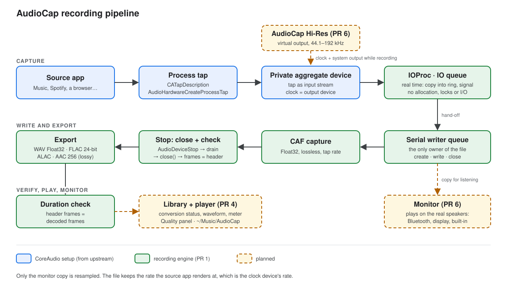
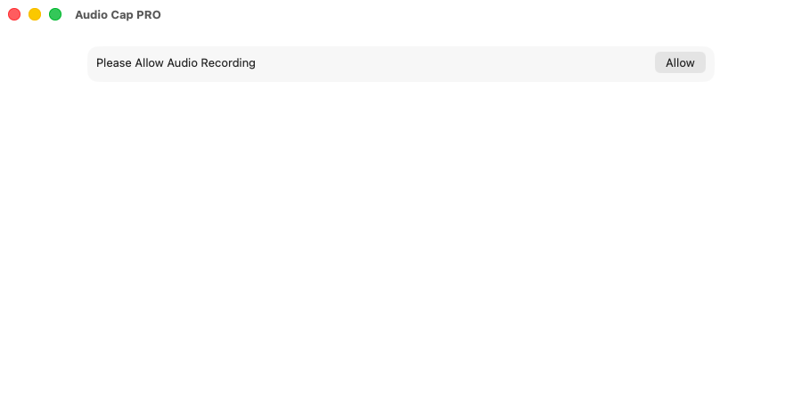
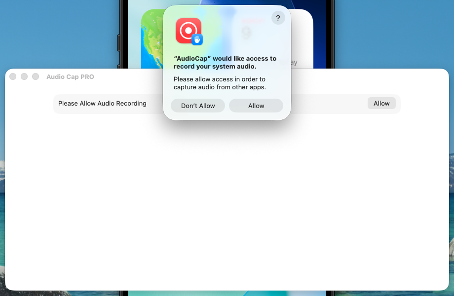
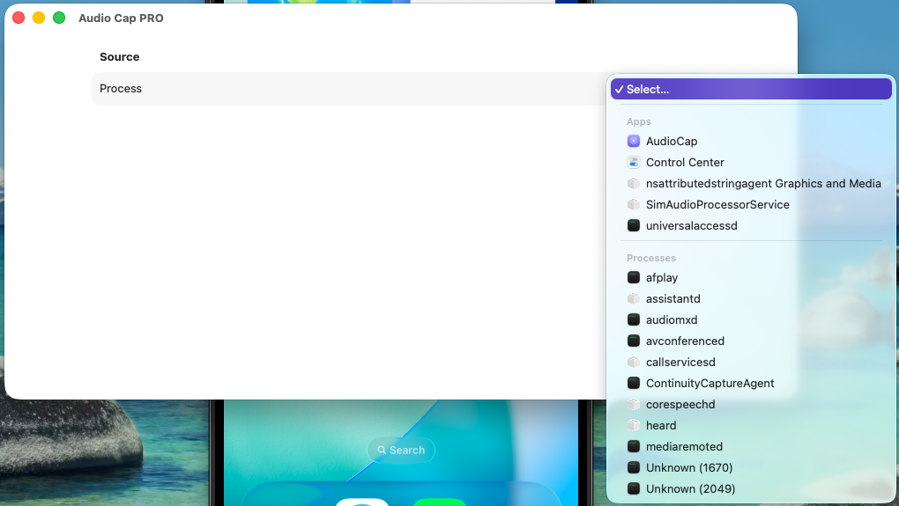
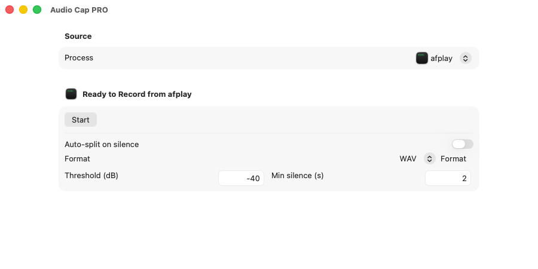
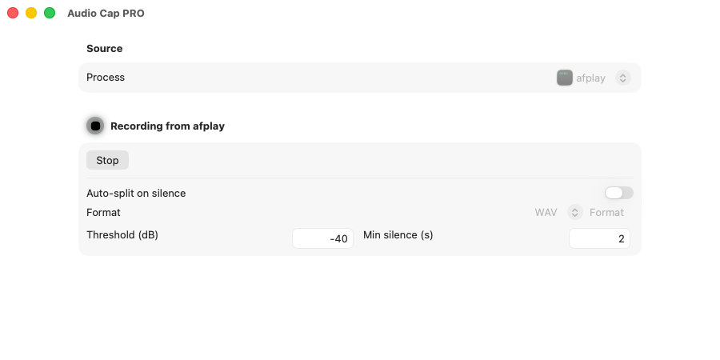
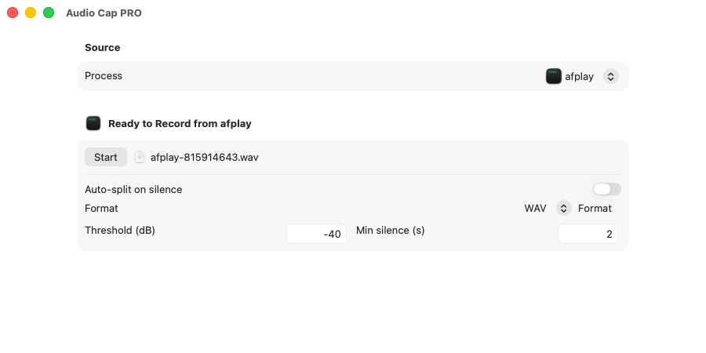

# AudioCap

[Español](README.es.md)

AudioCap records the sound of one app on your Mac (Music, Spotify, a browser…) straight from macOS, using CoreAudio **process taps**. No loopback driver, no microphone, no re-recording through the speakers.

This fork is being reworked after recording stopped working on a recent macOS update. The plan is in [`docs/planning/01_improvement_plan.md`](docs/planning/01_improvement_plan.md). This README marks clearly what the app does **today** and what is **planned**.



## Features

Available today:
- Pick any app that is playing audio and record only that app.
- Save as WAV (32-bit float), M4A (AAC) or FLAC.
- Optional split into separate files on silence, with a threshold (dB) and a minimum silence length (seconds).

Known problems in the current build (fixed by the new recording engine, PR 1):
- On recent macOS versions, starting a WAV recording can fail with error `1718449215` (`'fmt?'`), or the file can stay empty.
- FLAC files lose the last fraction of a second, and some files report a different length than the audio they contain.

Planned (see the plan for details):
- **New recording engine** (PR 1): lossless CAF capture, FLAC 24-bit, ALAC, WAV Float32, AAC 256 kbps; length check on every file; decoded error codes with a **Copy diagnostics** button.
- **Auto-record** (PR 3): arm it, and recording starts when the app makes sound and stops after silence. Plus an "All system audio" source.
- **Library and player** (PR 4): every take with its status (recording, converting, done, failed), a player with waveform, a level meter, a **Quality** panel and the output folder `~/Music/AudioCap`.
- **Spanish and English interface** (PR 5), with text of at least 16 pt.
- **Hi-Res mode** (PR 6): record at the source's full rate even when you listen on Bluetooth or display speakers.

## Requirements

- A Mac with **macOS 26** or later. The process-tap API exists since macOS 14.4, but the project currently targets macOS 26.0.
- **Xcode** (built here with Xcode 26.6). Install it from the App Store, open it once, then run `sudo xcode-select -s /Applications/Xcode.app` if `xcodebuild` is not found.
- Permission to record system audio (macOS asks the first time).

Windows and Linux are not supported: process taps are a macOS CoreAudio API.

## Installation

```
git clone https://github.com/juliatic/AudioCap.git
cd AudioCap
./start.sh
```

`./start.sh` checks for Xcode, builds a Release copy into `./build/AudioCap.app` and opens it. Other options:

| Command | What it does |
|---------|--------------|
| `./start.sh` | build and open the app |
| `./start.sh --no-open` | build only |
| `./start.sh --test` | run the unit tests (target `AudioCapTests`, added with the new engine) |
| `./start.sh --help` | show all options |

Without a Team ID the app is signed ad hoc, so macOS may ask for the permission again after each rebuild. To keep it, create `AudioCap/Config/Local.xcconfig` (git-ignored) with your Apple Team ID:

```
DEVELOPMENT_TEAM = XXXXXXXXXX
```

## Usage

1. Open AudioCap and click **Allow**, then confirm in the macOS prompt.

   
   

2. Start playback in the app you want to record, and pick it from the list.

   

3. Choose the format (and optional silence split), then click **Start**.

   
   

4. Click **Stop**. The file name appears when the file is written.

   

Recordings are currently saved in the app's container: `~/Library/Containers/codes.rambo.samplecode.AudioCap/Data/Library/Application Support/AudioCap` (see [Troubleshooting](docs/troubleshooting.md#where-recordings-are-saved)).

These screenshots show the current interface; they will be replaced when the interface is translated (PR 5).

## Recording quality

Short answer: lossless, but only bit-perfect when the sample rates match.

- **Bit depth:** the tap delivers 32-bit float, which holds 16- and 24-bit audio exactly. WAV keeps that float data; FLAC and ALAC (new engine) store 24-bit.
- **Sample rate:** a tap records at the rate the source app plays at, and the app plays at the rate of your **output device**. If a 96 kHz track plays to 48 kHz Bluetooth headphones or a 48 kHz display, it is resampled before AudioCap sees it. Match the output device's rate to the source (Audio MIDI Setup) for a bit-perfect copy. Hi-Res mode (planned, PR 6) removes this limit by routing playback through a virtual device while you keep listening on your speakers.
- **Channels:** surround and Atmos are folded down to stereo.
- **Source app settings:** app volume below 100 %, EQ, Sound Check and Spatial Audio change the audio before the tap.
- **AAC/M4A is lossy.** Use WAV, FLAC or ALAC to keep the original.

How to prove it on your own Mac (null test, duration check): [`.agents/skills/audiocap-audio-quality/SKILL.md`](.agents/skills/audiocap-audio-quality/SKILL.md).

## Troubleshooting

- [Troubleshooting guide](docs/troubleshooting.md): decoded error codes (`'fmt?'`, `'!obj'`…), resetting the permission, where files are saved, empty or short files.
- [CoreAudio process-tap notes](docs/coreaudio-taps.md) for developers.
- Contributors and AI tools: start with [`AGENTS.md`](AGENTS.md).

## Credits

AudioCap is based on [insidegui/AudioCap](https://github.com/insidegui/AudioCap), the upstream sample that documents the macOS 14.4 process-tap API. Thanks to its author and to [@WFT](https://github.com/WFT), who helped with the upstream project. The upstream licence is kept in [`LICENSE`](LICENSE) (BSD 2-Clause).

Upstream sponsor, as shown in the original README:

> **Sponsor: Recall.ai - API for desktop recording**
>
> If you’re looking for a hosted desktop recording API, consider checking out [Recall.ai](https://www.recall.ai/?utm_source=github&utm_medium=sponsorship&utm_campaign=audiocap), an API that records Zoom, Google Meet, Microsoft Teams, In-person meetings, and more.
