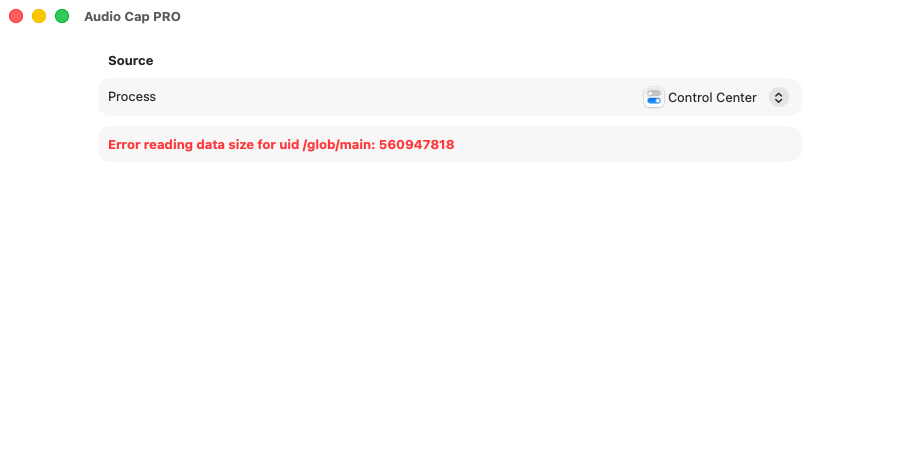

# Solución de problemas

[English](troubleshooting.md) · [README](../README.es.md)

## Descifrar un número de error

Los errores de CoreAudio y AVFoundation son códigos de cuatro caracteres guardados en un número de 32 bits. Para ver el código de cualquiera:

```
python3 -c 'import struct,sys; print(struct.pack(">i", int(sys.argv[1])))' 1718449215
```

| Número | Código | Qué significa | Qué hacer |
|--------|--------|---------------|-----------|
| `1718449215` | `'fmt?'` | Formato de datos no admitido: los ajustes del archivo o del conversor no encajan con el audio que llega. Es el error del informe original ("Wav recording error … error 1718449215"). | Actualiza a la versión con el nuevo motor de grabación (PR 1), que lee el formato del dispositivo ya en marcha. Si sigue pasando, pulsa **Copiar diagnóstico** y adjunta el informe a una incidencia. |
| `560947818` | `'!obj'` | Objeto de audio no válido: la app elegida se ha cerrado o el Mac no tiene ninguna salida de audio utilizable. Aparece como "Process tap creation failed with error 560947818" y "Error reading data size for uid /glob/main: 560947818". | Pon algo a sonar en la app de origen, vuelve a elegirla en la lista y comprueba en Ajustes del Sistema → Sonido que hay una salida. |
| `560227702` | `'!dev'` | Dispositivo no válido: el dispositivo agregado o la salida han desaparecido. | Para, vuelve a conectar la salida (Bluetooth, pantalla) y empieza de nuevo. |
| `2003332927` | `'who?'` | Propiedad desconocida: el dispositivo no admite lo que se le pide. | Abre una incidencia con el diagnóstico e indica tu versión de macOS. |
| `1852797029` | `'nope'` | Operación no permitida para este dispositivo o en este estado. | Para la grabación y vuelve a empezar. |
| `561211770` | `'!siz'` | Tamaño de propiedad incorrecto. | Abre una incidencia con el diagnóstico. |
| `1937010544` | `'stop'` | El dispositivo no está en marcha. | Pon algo a sonar en la app de origen y vuelve a empezar. |
| `2003329396` | `'what'` | Error de CoreAudio sin especificar. | Abre una incidencia con el diagnóstico. |



## Permiso

AudioCap necesita el permiso de **grabación de audio del sistema**. La primera vez, macOS pregunta si AudioCap puede grabar el audio del sistema: pulsa **Permitir**.

Si pulsaste **No permitir** o el aviso no aparece:

1. Abre Ajustes del Sistema → Privacidad y seguridad → Grabación de pantalla y audio del sistema, y activa AudioCap en "Solo grabación de audio del sistema" (los nombres exactos pueden variar un poco según la versión de macOS).
2. O borra la decisión desde Terminal y vuelve a abrir la app para que el aviso salga otra vez:
   ```
   tccutil reset AudioCapture codes.rambo.samplecode.AudioCap
   ```
   Cuando se aplique el cambio de identificador previsto en el plan, será `io.github.juliatic.AudioCap`.

Las compilaciones con firma ad hoc (lo que hace `./start.sh` si no hay Team ID) cambian de firma cada vez que recompilas, así que macOS puede volver a pedir el permiso la primera vez que se abre la copia recompilada. `./start.sh` instala cada compilación como `/Applications/AudioCap.app`, así que cuenta con que el aviso vuelva tras recompilar, y una vez más cuando cambie el identificador de la app (bundle ID) con el nuevo motor. Si pones tu Team ID en `AudioCap/Config/Local.xcconfig` (`DEVELOPMENT_TEAM = XXXXXXXXXX`), el permiso se mantiene entre compilaciones.

## Dónde se guardan las grabaciones

- **Versión actual:** dentro del contenedor aislado de la app, que Finder no muestra:
  `~/Library/Containers/codes.rambo.samplecode.AudioCap/Data/Library/Application Support/AudioCap`
  Para abrirlo desde Terminal: `open ~/Library/Containers/codes.rambo.samplecode.AudioCap/Data/Library/Application\ Support/AudioCap`.
- **Previsto (PR 4):** `~/Music/AudioCap` por defecto, con un selector para cambiar la carpeta y **Mostrar en Finder** desde la biblioteca.

## La grabación está vacía o dura lo que no debe

- Un WAV de 4096 bytes justos y sin duración solo tiene la cabecera: no llegó audio al archivo. Es lo que hace el motor original cuando no consigue crear sus búferes (en el registro aparece "Failed to create PCM buffer"). El motor nuevo lo muestra como error.
- Si los reproductores siguen sonando después de la duración que indican, o un FLAC se corta antes de tiempo, compara la duración de la cabecera con la decodificada como se explica en [`.agents/skills/audiocap-audio-quality/SKILL.md`](../.agents/skills/audiocap-audio-quality/SKILL.md#duration-check-header-vs-decoded).

## La grabación no tiene la calidad del original

Un tap de proceso graba a la frecuencia a la que suena la app de origen, y esa la fija tu dispositivo de salida. Los auriculares Bluetooth y la mayoría de pantallas van a 48 kHz, así que una pista de 96 kHz llega ya remuestreada. Lo explica el apartado "Calidad de grabación" del [README](../README.es.md#calidad-de-grabación).

## Recoger registros

```
log show --last 10m --style compact --predicate 'process == "AudioCap"'
```
